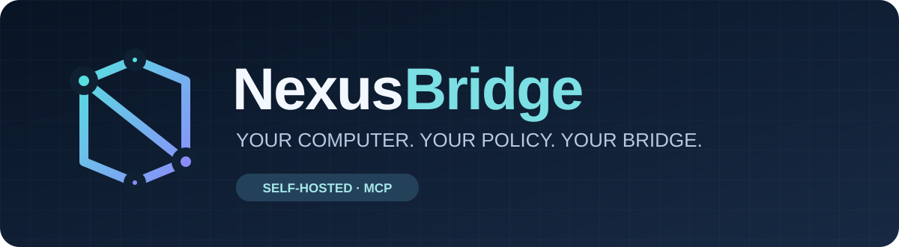
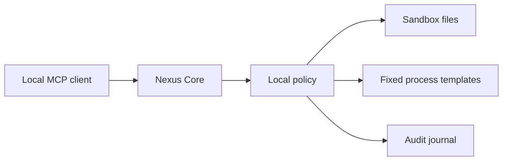

<div align="center">



**A self-hosted bridge between AI conversations and your own computer.**


[](https://github.com/KamenevVA/NexusBridge/actions/workflows/ci.yml)

[Русский](README.ru.md) · [Roadmap](docs/ROADMAP.md) · [Security](SECURITY.md) · [Contributing](CONTRIBUTING.md)

</div>

## What is NexusBridge?

NexusBridge is a Windows-first project for connecting an ordinary ChatGPT conversation to owner-authorized computer operations using the Model Context Protocol (MCP). The target architecture keeps the execution policy and data on your own infrastructure. It does not require a separate paid text-generation API.

> **Development alpha — not production-ready.** This public snapshot is a local, isolated MCP development sandbox. It does not provide general remote PC access, arbitrary shell execution, a GUI, or a permanent HTTPS endpoint. A separate restricted ChatGPT Desktop integration proof succeeded in the owner's environment; compatibility on other accounts, web and mobile is not guaranteed.

## Current capabilities

| Module | Available in alpha.5 |
| :--- | :--- |
| Files | Directory listing/tree, text and binary reads/writes, search, copy, exact-match edits, ordered patches, native same-volume move, recoverable trash and restore |
| Integrity | SHA-256 conflict checks, bounded inputs, backup before replacement |
| Processes | Exact-approved fixed executable templates, native Windows Job Objects, bounded input/output and descendant cancellation |
| Guard | Read-only default, exact one-time owner approvals, local emergency stop, path checks and persistent redacted audit |
| MCP | Local stdio server with 25 tools when both sandbox flags are enabled; 11 read-only tools by default |

## Architecture



The future ChatGPT HTTPS ingress, relay, desktop helper and GUI are separate workstreams, not features of this public runner.

## Quick start

Requirements: Windows 11 x64, Node.js 24.x, npm and Git. Run without elevation.

```powershell
git clone https://github.com/KamenevVA/NexusBridge.git
cd NexusBridge
npm ci --ignore-scripts
npm run typecheck
npm test
```

Start the local stdio server (read-only by default):

```powershell
node src/mvp-stdio.ts
```

For a local MCP client testing the disposable sandbox, pass `--sandbox-write` and/or `--sandbox-exec` explicitly. The latter enables only a fixed self-test process, with a one-time local approval. Move, trash and restore also require exact local approval. Native helpers are compiled by npm test or npm run build:native using the installed Windows .NET Framework x64 compiler. The server communicates using stdio, not a TCP listener. Do not expose this alpha to the internet.

For an approval request, the local owner reviews the exact operation using the session name printed to stderr. Run the following in a separate local terminal (not through MCP):

    node scripts/guard-local.mts list alpha-SESSION
    node scripts/guard-local.mts approve alpha-SESSION APPROVAL-UUID
    node scripts/guard-local.mts stop alpha-SESSION

Approval is single-use, bound to the exact operation and expires. The experimental dedicated profile runner passed a restricted non-admin Windows test in the owner environment; it does not yet enforce a separate network sandbox and is not production-ready.

## Road to 1.0

| Gate | Objective | State |
| :--- | :--- | :--- |
| G0-L | Restricted ChatGPT Desktop integration proof | Verified in owner environment |
| G1 | Files, process control and local guard | In development |
| G2 | Stable authenticated relay | Pending |
| G3 | Console, onboarding and installer | Pending |
| G4 | Workspaces, Git and workflows | Pending |
| G5 | Desktop vision and UI automation | Pending |
| G6 | Multi-device infrastructure | Pending |
| G7 | Security review, soak testing and production release | Pending |

See the [detailed roadmap](docs/ROADMAP.md), [changelog](CHANGELOG.md) and [security policy](SECURITY.md).

## Repository scope

Public development snapshots contain reviewed generic source and synthetic tests. Private runtime data, account-specific integration logs, credentials and infrastructure configuration are excluded. The public test suite covers the published modules; internal integration tests are tracked separately.

No open-source license has been selected yet. Do not assume permission to redistribute or reuse the code beyond applicable law and GitHub's terms. NexusBridge is an independent project, not an official OpenAI product.
