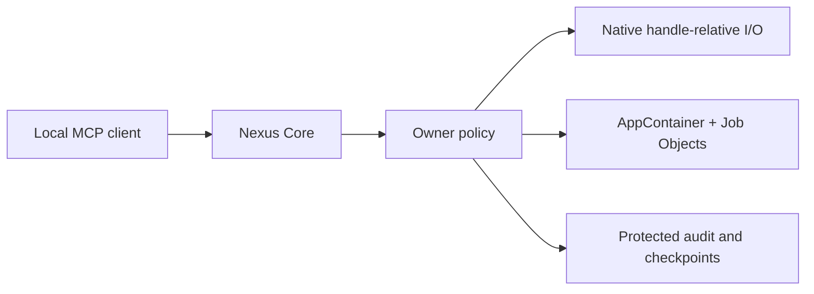

<div align="center">


**A self-hosted bridge between AI conversations and your own computer.**


[](https://github.com/KamenevVA/NexusBridge/actions/workflows/ci.yml)

[Русский](#русский-язык) · [Roadmap](docs/ROADMAP.md) · [Local MVP runbook](docs/G1-LOCAL.md) · [Security](SECURITY.md) · [Contributing](CONTRIBUTING.md)

</div>

## English

<details open>
<summary>English — expand / collapse</summary>

## NexusBridge v0.1.0

NexusBridge is a Windows-first project for owner-authorized computer operations through MCP. Its target architecture keeps execution policy and data on your own infrastructure, without a separate paid text-generation API.

**G1 local MVP accepted in the owner's Windows environment. Not production 1.0.** The current public snapshot provides local stdio only, not a general remote terminal, permanent HTTPS endpoint, GUI or installer. A separate restricted ordinary ChatGPT Desktop integration proof succeeded; independent web/mobile compatibility remains pending.

| Module | Local MVP |
|---|---|
| Files | Native handle-relative list, read, create, write, move and recoverable trash; binary/text pagination, exact patches, copy and search |
| Recovery | SHA-256 conflicts, protected checkpoints, interrupted-write recovery |
| Processes | Owner-approved fixed executable/args/hash, AppContainer zero capabilities and Job Objects in a dedicated local profile |
| Guard | Read-only default, local one-time approvals, emergency stop, redacted audit, owner anchor/archive/retention |
| MCP | 26 tools with explicit capabilities, 11 read-only by default |

## Architecture



The Job-only disposable runner is synthetic. The dedicated profile adds the OS principal and AppContainer boundary; it requires owner-side ACL provisioning. Future remote ingress and relay are separate gates.

## Quick start

Windows 11 x64, Node.js 24.x, Git and installed Windows .NET Framework x64 compiler. Run without elevation:

```powershell
git clone https://github.com/KamenevVA/NexusBridge.git
cd NexusBridge
npm ci --ignore-scripts
npm run typecheck
npm test
node src/mvp-stdio.ts
```

Read-only by default. For disposable tests, pass explicit `--sandbox-write` or `--sandbox-exec`; exec offers only the synthetic fixed self-test template. Local owner approvals and dedicated profile provisioning are documented in [G1-LOCAL.md](docs/G1-LOCAL.md). Do not expose either runner over a tunnel.

## Verification

The local acceptance suite passed 31/31 internal tests, plus separate non-admin Windows and AppContainer TCP proofs. The public suite excludes account-specific G0 tests and private proof controllers. CI verifies the public source; it does not certify every Windows configuration or live ChatGPT account.

## Road to 1.0

| Gate | Objective | State |
|---|---|---|
| G0-L | Restricted ChatGPT Desktop integration | Passed in owner environment |
| G1 | Local filesystem, restricted processes and guard | Passed in owner environment |
| G0-R | Independent web/mobile integration | Pending |
| G2 | Stable authenticated relay | Blocked by G0-R |
| G3–G7 | Console, workflows, vision, infrastructure, production | Pending |

See the [roadmap](docs/ROADMAP.md), [changelog](CHANGELOG.md) and [security policy](SECURITY.md).

Public snapshots exclude private runtime data, credentials, account-specific logs and infrastructure configuration. No open-source license has been selected. NexusBridge is independent, not an official OpenAI product.

</details>

## Русский язык

<details>
<summary>Русский — раскрыть / свернуть</summary>

# NexusBridge v0.1.0

Независимый self-hosted мост между ИИ-чатом и компьютером владельца через MCP.

[English](#english) · [Дорожная карта](docs/ROADMAP.md) · [Локальный запуск](docs/G1-LOCAL.md) · [Безопасность](SECURITY.md)

**G1 — локальный MVP принят на Windows владельца. Это не production 1.0.** 26 инструментов MCP при явном включении разрешений, 11 только чтения по умолчанию. Стабильный удалённый relay, GUI, установщик и произвольный терминал не реализованы.

- Нативные операции с проверенными файловыми дескрипторами, SHA-256, двоичные данные, патчи, корзина, checkpoints и восстановление после прерывания.
- Отдельная непривилегированная учётная запись, AppContainer без capabilities и Windows Job Objects для разрешённых шаблонов команд.
- Локальное точное одноразовое подтверждение, аварийная остановка, защищённый журнал и архивирование.
- 31/31 внутренних тестов прошли; отдельно проверены ACL и сетевое ограничение AppContainer. Публичный набор не включает приватные тесты аккаунта.

## Проверка

Windows 11 x64, Node.js 24.x, Git, установленный x64 компилятор .NET Framework. Запуск без прав администратора:

```powershell
git clone https://github.com/KamenevVA/NexusBridge.git
cd NexusBridge
npm ci --ignore-scripts
npm run typecheck
npm test
node src/mvp-stdio.ts
```

Последняя команда запускает одноразовую тестовую среду только для чтения. Защищённый профиль требует отдельной локальной настройки владельцем; см. [инструкцию](docs/G1-LOCAL.md). Не публикуйте сервер через туннель. G0-L подтверждён в обычном ChatGPT Desktop владельца, G0-R web/mobile остаётся отдельным обязательным этапом. Публичный репозиторий не содержит частных журналов, конфигураций и ключей. Лицензия пока не утверждена.

</details>
